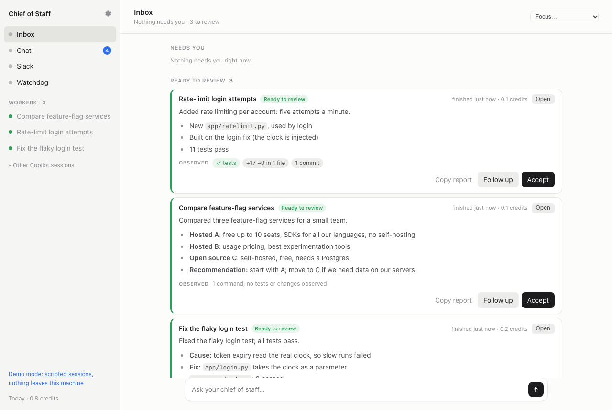
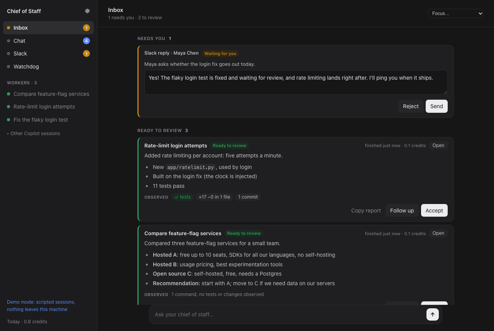

# Chief of Staff

**English** · [简体中文](README.zh-CN.md)

One inbox for all your GitHub Copilot sessions. Tell it what you need. It gives each task to
its own Copilot session, sends follow-ups to the session that already has the context, drafts
your Slack replies, and lets you know when something is ready to review.



Try it with scripted sessions first. No account needed:

```bash
uvx chiefofstaff --demo
```

## Why I built this

I usually have several Copilot sessions going at once: one fixing a test, one reviewing a PR,
one digging through logs. Every few minutes I'd flip between terminals to see which one was
stuck, which one had a question, and which one had quietly finished. Slack kept pinging me in
between. After a while I couldn't remember which session knew what, and I'd start a new one for
a follow-up that an old one could have answered in a minute.

Now I talk to one session, the Router, and Chief of Staff keeps track of the rest.

## What it does

- Splits a request into tasks. "Fix the flaky login test, then add rate limiting, and compare
  feature-flag services" becomes three tasks. The second waits for the first and starts with
  its result.
- Sends follow-ups to the session that did the work, with its history and checkout, instead of
  starting over in a new one.
- Shows what was observed next to what the worker reports: the test runs, commits, diff and PR
  checks. If a report says "all tests pass" and no test ran, the card says so.
- Lets you review the diff, comment on lines and send the comments back to the worker, then open
  the PR with one click. The worker follows the PR; when it merges, the task is done.
- Checks results against acceptance criteria: each is marked verified only when a command the
  worker was seen running backs it, and evidence goes out of date when the code changes.
- Brings you decisions, not just questions: why, the options and their effects, a
  recommendation. Change a decision later and every task that relied on it adjusts and
  confirms.
- Learns how you work from your decisions, review comments and draft edits, as lessons you
  approve, so the sessions get closer to doing it your way.
- Leaves your own checkout alone. Each worker gets its own folder and git worktree.
- Workers can do what your own Copilot sessions can: your plugins, MCP servers, skills, custom
  agents and tools. Turn on the sandbox in Settings to confine them to their folders; workers
  that read Slack are always sandboxed.
- Drafts replies to Slack DMs and mentions in your style. Nothing is sent until you press Send.
- Lets you delegate from Slack: react 🤖 to any message ("can someone look at the export
  bug?") and it becomes a task. When it's done, the answer is drafted in that thread.
- Has a focus mode. Pick how long: notifications wait, the Router handles what it can, and you
  get one summary at the end.
- Watches for workers that stall or go in circles, and nudges them.

It runs on the Copilot you already have: your plan, your models, your MCP servers and your
company's policies. No other AI service or API key.



## Install

You need macOS or Linux, Python 3.11 or newer, [uv](https://docs.astral.sh/uv/getting-started/installation/)
(or pipx), and the [GitHub Copilot CLI](https://docs.github.com/en/copilot/how-tos/copilot-cli):

```bash
npm install -g @github/copilot
copilot login
uvx chiefofstaff            # or: pipx install chiefofstaff && chiefofstaff
```

Your browser opens `http://127.0.0.1:8765`. Tell it where your code lives (like `~/workspace`),
then type what you need in the box at the bottom. Repositories a task needs that aren't there
yet get cloned into that folder, and each worker works in its own git worktree inside it, so
your own checkouts are never touched.

Everything runs on your machine, and your data stays in `~/Library/Application Support/chiefofstaff`
(macOS) or `~/.local/share/chiefofstaff` (Linux). Closing the tab doesn't stop anything; press
Ctrl+C in the terminal to stop. Sessions continue where they left off when you start it again.
If it's already running, starting it again just opens the page.

Options: `--port`, `--data-dir`, `--no-browser`, `--demo`. To update: `uvx chiefofstaff@latest`
or `pipx upgrade chiefofstaff`.

## Signing in

There are a few separate sign-ins. Only the first one is required.

1. **Copilot.** Run `copilot login` once. If you haven't, the page tells you what to do. On a
   company plan, an admin may need to turn on Copilot CLI for you.
2. **The page itself.** Every start prints a private link with a fresh token in the terminal
   and opens it for you. It stays signed in for 24 hours. After a restart, use the new link.
   Keep it to yourself: whoever has it can act as you.
3. **GitHub**, to review PRs you're asked to review: `gh auth login`. Sign in with every account
   you use (your company's too): Chief of Staff uses the one that can see each repository. With
   the sandbox on, also run `copilot sandbox ca create && copilot sandbox ca trust` once, so
   `gh` works inside it.
4. **Slack and other services.** Paste a Slack user token in Settings
   ([how to get one](docs/guide.md#slack)).
   When a worker needs another service, like your docs or issue tracker, a sign-in card shows
   up in the inbox.

## How it works

Every session is a regular Copilot CLI session. You'll find them in `copilot --resume`, named
"Chief of Staff · …". Chief of Staff drives them through the Copilot SDK:

```
you ── inbox ── Router ── tasks ──► worker · worker · worker
                  ▲                 (own folder, worktree, sandbox)
Slack, GitHub ────┘    Slack session ──► drafts you approve
                       Watchdog ──► nudges stuck workers
```

Sessions never talk to each other directly. They call tools like `spawn_worker`, `report` or
`ask_session`, and Chief of Staff delivers the message. Each message is saved before it's sent
and labeled with who it's from, so a Slack message can't pass itself off as you.

- [User guide](docs/guide.md)
- [Architecture](docs/ARCHITECTURE.md)
- [Security](SECURITY.md): what the OS
  sandbox enforces, what Chief of Staff enforces, and what relies on the model following
  instructions.

## Status

Early (0.1). Expect rough edges. Copilot usage counts against your plan like any other
session, and the inbox shows the credits each task used.

Bug reports and ideas are welcome as issues. If you'd like to contribute, start with
[CONTRIBUTING.md](CONTRIBUTING.md) and the
[good first issues](docs/good-first-issues.md).

## License

MIT. Chief of Staff is an independent project, not made by or affiliated with GitHub. GitHub
Copilot is a trademark of GitHub, Inc.
