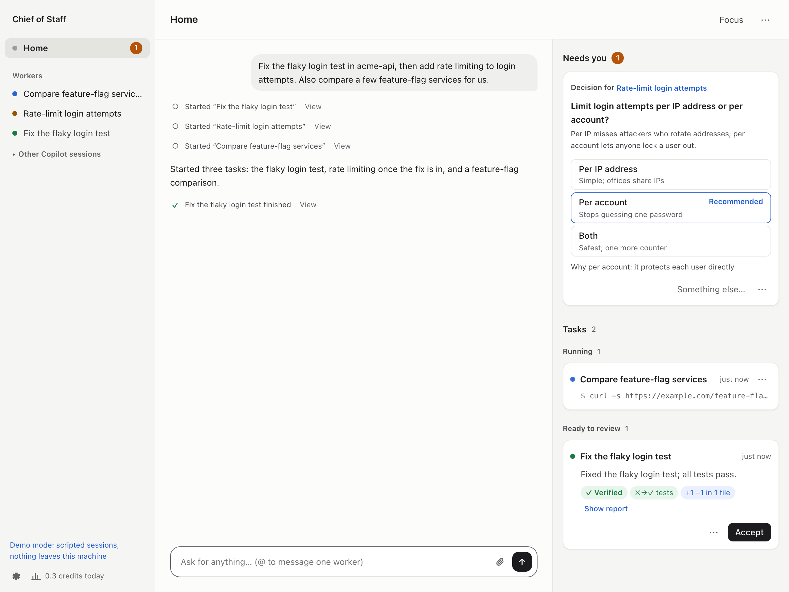

# Chief of Staff

**English** · [简体中文](README.zh-CN.md)

[](https://pypi.org/project/chiefofstaff/) [](https://pypi.org/project/chiefofstaff/) [](LICENSE)

Your engineering chief of staff. It catches what comes to you (a question in Slack, a PR to
review, a comment on your doc), gets it done with Copilot, and answers in your voice: with
proof of what was done, and only once you say OK. The longer it works for you, the better it
knows how you work.

**It does the work. It drafts the words. You make the call.**

<p align="center"></p>



```bash
uvx chiefofstaff --demo    # try it with scripted sessions, no sign-in needed
```

## Why

Most of my day isn't writing code. It's answering a question in Slack, reviewing a PR,
following up on a thread, checking whether a run finished. Copilot can do most of that, but I
still had to notice each ask, start a session, keep an eye on it and write the reply myself.
Chief of Staff does the noticing and the follow-through. I talk to one session, the Router: it
hands each ask to its own Copilot session, keeps track of all of them, and comes back to me
only with a decision to make or a draft to approve.

## What it does

**Catches what comes to you**
- Watches what you ask it to (Slack mentions, doc comments, mail) with any tool your Copilot
  has, Glean or your company's search included, and turns what needs doing into tasks.
- React 🤖 to any Slack message, press a hotkey from any app, or just say what you need.
- Sends a follow-up to the session that did the work, with its history and checkout.

**Answers in your voice, once you say OK**
- Drafts Slack replies and PR reviews, approvals included, the way you write them.
- Sends them only when you approve; you can edit a draft first.

**Shows proof, not just claims**
- Shows what was observed next to each report (test runs, commits, diff, PR checks), and flags
  claims nothing backs.
- Lets you comment on the diff, send it back, and open the PR in one click.

**Learns how you work**
- Picks up how you write and what you keep asking for. Your style applies at once; habits wait
  for your OK.
- Turns mistakes workers fixed into checks that catch them next time.

**Guards your focus**
- Asks only when it needs you: one card per thing, a decision with options and a
  recommendation, a question, a draft.
- Reaches you when you are away from your desk (through your company's Slack bot, say) and
  takes your answers from there.
- Focus mode holds notifications and gives you one summary at the end; a daily summary says what
  finished, what waits for you and what was handled without you.

**Keeps many things moving at once**
- Splits a request into tasks and runs each in its own Copilot session, in parallel or in order.
- Shows every task live on one board: what it is doing now, what waits and why, what is done.
- The captain, the duck beside the name, shows how things stand at a glance: it salutes when
  something needs you, takes the wheel while work runs, keeps watch while tasks wait, and
  cheers when a task is done.

**Your Copilot, your machine**
- Uses the Copilot you already have: your plan, models, plugins, skills, MCP servers and your
  company's policies, plus anything you add in Settings. No other AI service or API key.
- If you also use Codex, workers can run on it instead, with your own Codex sign-in: turn it
  on in Settings ([how](docs/guide.md#workers-on-other-coding-agents)).
- Every worker gets its own folder and git worktree, so your checkouts stay untouched. Workers
  run like your own Copilot sessions (those that read Slack keep permission checks by default); turn on
  *Ask first* for all of them (no pushes to `main`, no force pushes, no writes outside their
  folders) or an OS sandbox in Settings.

## Install

You need macOS, Linux or Windows (experimental), Python 3.11+, [uv](https://docs.astral.sh/uv/getting-started/installation/)
(or pipx) and the [GitHub Copilot CLI](https://docs.github.com/en/copilot/how-tos/copilot-cli):

```bash
npm install -g @github/copilot
copilot login
uv tool install chiefofstaff && chiefofstaff   # or: pipx install chiefofstaff
```

Your browser opens Chief of Staff through a private link printed in the terminal (keep it to
yourself). Tell it where your code lives, like `~/workspace`, and type what you need.

Everything runs on your machine; data stays in `~/Library/Application Support/chiefofstaff`
(macOS), `~/.local/share/chiefofstaff` (Linux), or `%LOCALAPPDATA%\chiefofstaff\chiefofstaff`
(Windows; with a Python installed from the Store app, Windows keeps it under that Python's
`%LOCALAPPDATA%\Packages\...\LocalCache` instead: the `Data:` line at startup says where).
Ctrl+C stops it, and sessions pick up where they left off next time. Options: `--port`,
`--data-dir`, `--no-browser`, `--demo`. Update with
`uv tool upgrade chiefofstaff`. Launching `uvx chiefofstaff@latest` again and again works too,
but each new version leaves a cached environment behind in uv's cache: `uv cache prune` removes
the ones nothing uses. Never run `uv cache clean` while Chief of Staff is running: it can delete
the environment it runs from. Workers' folders, and how much disk they take, are under Storage
(the disk icon at the bottom of the sidebar).

On Windows (experimental), Send to Chief, the Copilot command sandbox, sandboxed checks and
the folder sizes under Storage (measured with `du`) are unavailable. Workers can access files
and networks available to your Windows account.
A new data directory, and the private launch link in it, are made readable only by you (and
SYSTEM and Administrators) with an access control list; a `--data-dir` that already exists
keeps its own, so check it. Storage cleanup cannot see programs running as administrator in a
worker's folder: close those before closing the worker. Git can still hit path length limits
in deeply nested folders; use a shorter project or data directory if that happens.

To start this checkout after `uv sync --extra dev`:

```powershell
.\.venv\Scripts\python.exe -m chiefofstaff
```

**Optional sign-ins**
- **GitHub**: `gh auth login` with every account you use, to review PRs and open them.
- **Slack**: paste a user token in Settings ([how](docs/guide.md#slack)), or reach Slack through
  a tool your Copilot already has, such as Glean.
- **Other services** (docs, issue trackers): a sign-in card appears when a worker needs one.

## How it works

Each session is a regular Copilot CLI session, driven through the Copilot SDK; `copilot --resume`
lists them as "Chief of Staff · …". A Codex worker is a thread of its own `codex app-server`.
Sessions never talk to each other directly: they call tools
such as `spawn_worker`, `report` and `tell_session`, and Chief of Staff delivers each message,
labeled with who sent it, so a Slack message cannot pass itself off as you. Workers that work
together pass what the other needs straight to it; the Router gets a copy.

```
you ── Home ── Router ── tasks ──► worker · worker · worker
                 ▲                 (own folder and worktree)
Slack, GitHub, ──┘    drafts ────► wait for your approval
your watches          Watchdog ──► nudges stuck workers
```

## Learn more

- [User guide](docs/guide.md)
- [Architecture](docs/ARCHITECTURE.md)
- [Security](SECURITY.md): what the OS sandbox, Chief of Staff and the model each enforce
- [Changelog](CHANGELOG.md)

## Status

Early (0.1): expect rough edges. Copilot usage counts against your plan, and Home shows the
credits each task used. Issues and ideas are welcome; to contribute, see
[CONTRIBUTING.md](CONTRIBUTING.md).

## License

MIT. Chief of Staff is an independent project, not made by or affiliated with GitHub. GitHub
Copilot is a trademark of GitHub, Inc.
