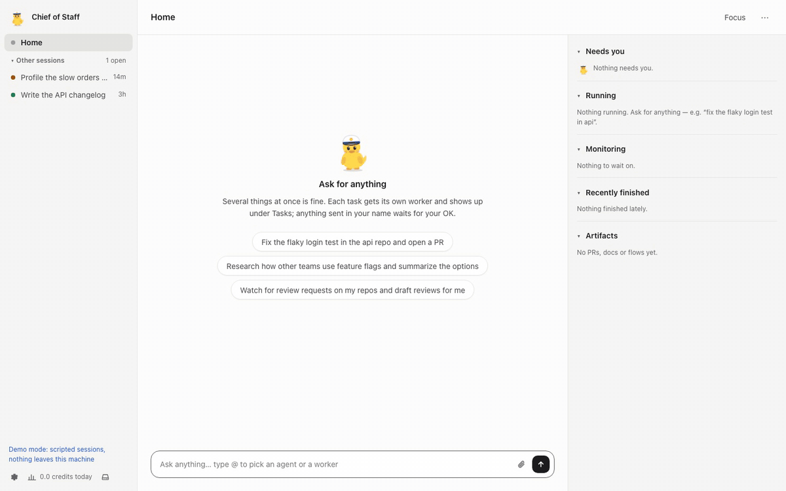
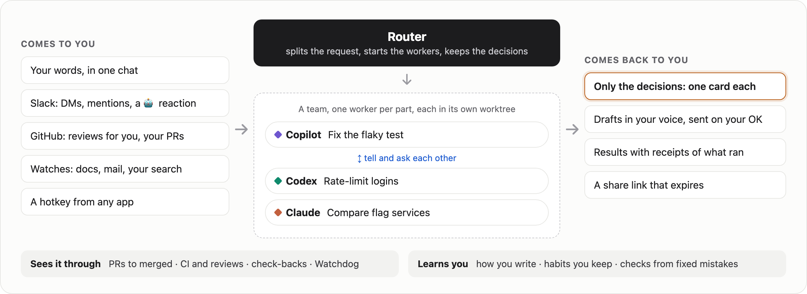
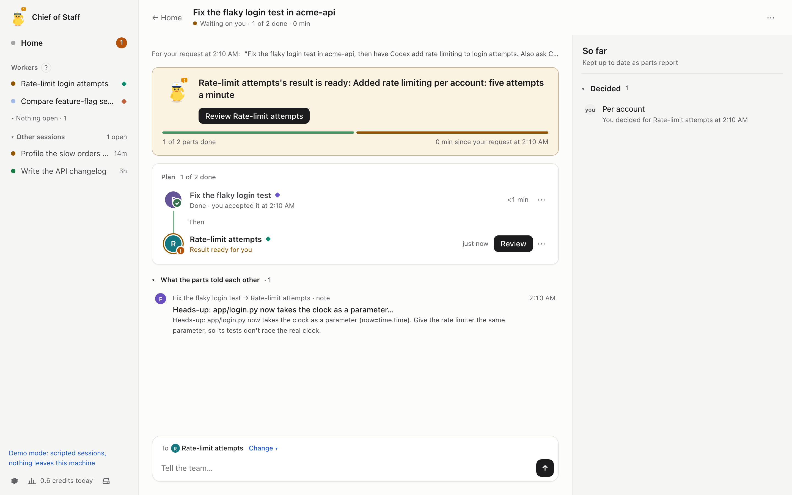
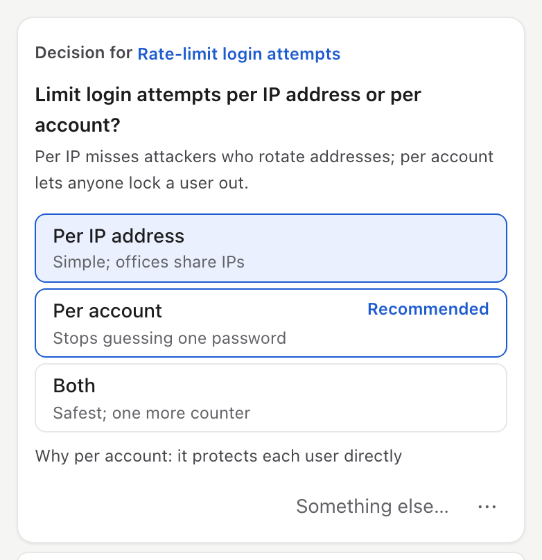
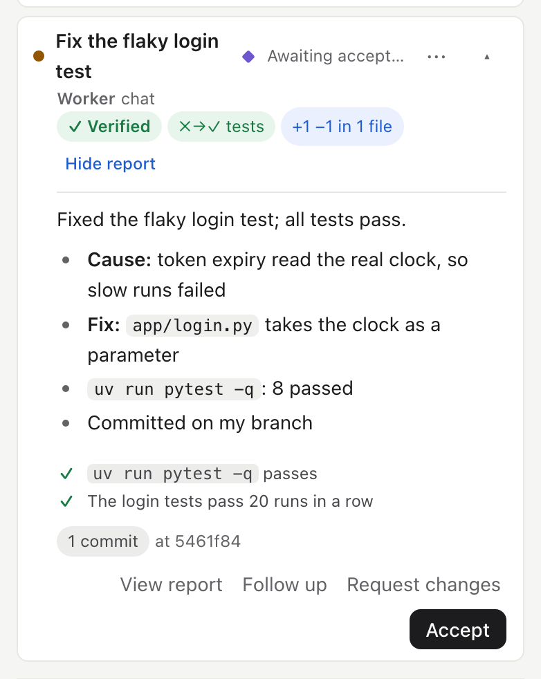
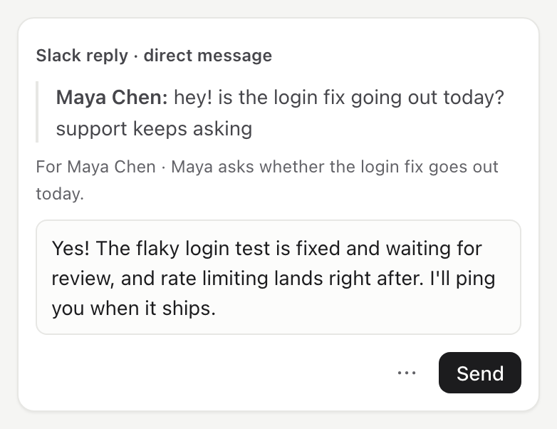
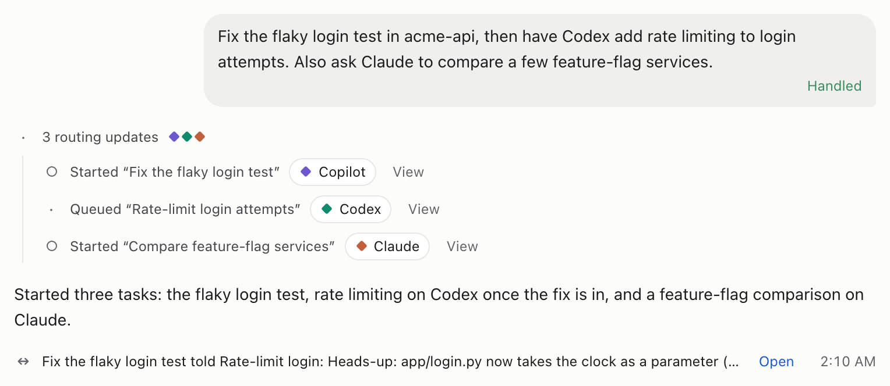
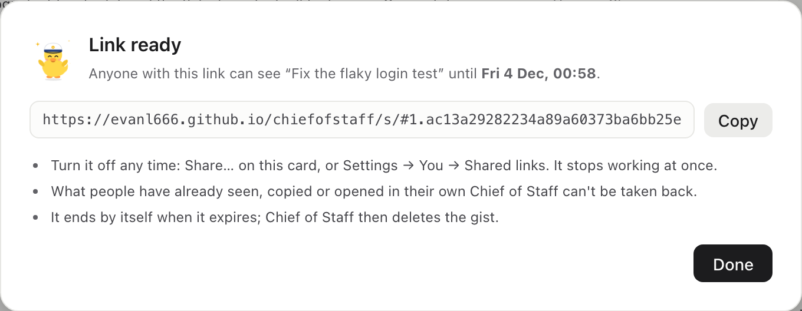

<p align="center">
  
</p>

<h1 align="center">Chief of Staff</h1>

<p align="center">
  <b>Your engineering chief of staff. The more it works for you, the more it works like you.</b>
</p>

<p align="center">
  It runs Copilot, Codex and Claude as one team whose agents talk to each other, follows every
  piece of work through to done, reaches you wherever you are, and brings you only the decisions.
</p>

<p align="center">
  <a href="https://pypi.org/project/chiefofstaff/"></a>
  <a href="https://pypi.org/project/chiefofstaff/"></a>
  <a href="https://github.com/evanl666/chiefofstaff/blob/main/LICENSE"></a>
  
</p>

<p align="center"><b>English</b> · <a href="https://github.com/evanl666/chiefofstaff/blob/main/README.zh-CN.md">简体中文</a></p>

<p align="center">
  <picture>
    <source media="(prefers-reduced-motion: reduce)" srcset="https://raw.githubusercontent.com/evanl666/chiefofstaff/main/docs/images/hero.png">
    
  </picture>
  <br>
  <sub>The real app in demo mode, 24 seconds. <a href="https://raw.githubusercontent.com/evanl666/chiefofstaff/main/docs/images/hero.mp4">Full quality (MP4)</a></sub>
</p>

## Try it in 10 seconds

```bash
uvx chiefofstaff@latest --demo   # scripted agents: no sign-in, nothing leaves your machine
uvx chiefofstaff@latest          # with Copilot CLI, Codex CLI or Claude Code signed in
```

No `uv`? `pipx run chiefofstaff --demo` works too. The browser opens by itself.

## What it does

1. **Learns to work like you, and from its own mistakes.** It picks up how you write (your Slack
   messages, PR reviews, commits) and what you keep asking for; habits wait for your OK. When a
   worker fixes a failing test, it proposes a check that fails on the mistake and passes on the
   fix: proved on both, so that mistake is caught next time.
2. **A team that talks to itself.** One request becomes parts, each worker on its own agent and
   worktree. They tell and ask each other directly, wait on each other's results and share your
   decisions; a live team page shows the plan. Or run one task on two agents and compare.
3. **Sees it through to done.** It keeps your PRs moving: when CI fails or reviewers comment, the
   same worker prepares the fix or the replies for your OK (*Keep my PRs moving*). Slack threads
   and PRs it follows go straight to their worker, check-backs watch long runs, and the Watchdog
   nudges stalled work.
4. **Reach it from anywhere.** React 🤖 to any Slack message to hand it over, or send work from
   any app with a hotkey. When you're away, what needs you comes to you (a Slack DM, say), and
   you answer right there.
5. **Only decisions reach you.** One card per question, with options and a recommendation.
   Workers that hit the same question share it, and your one answer reaches all of them. Every
   result comes with receipts: the tests, commits and diff it saw, not just what the agent says.
6. **Never acts as you.** It drafts Slack replies and PR reviews in your voice and sends them only
   on your OK. Workers can't comment, review, merge or close on GitHub as you, push to `main`, or
   force-push someone else's branch.
7. **Share in one link.** A finished result becomes an encrypted link that expires, opened in
   any browser; whatever looks private is flagged for you to remove first.
8. **The basics.** Copilot CLI, Codex CLI and Claude Code, mixed per task on the subscriptions you
   already have; when one hits its limit, new work starts on the next. It continues sessions you
   started in a terminal. Local, open source (MIT).

## What you stop doing

| Before | With Chief of Staff |
| --- | --- |
| Watching five terminal tabs to see which agent is stuck | One chat. Every task shows its live step; stalled ones get nudged |
| Copying context from one agent to another | Workers tell each other what changed, in their own words |
| Answering the same question for three agents | One card; your answer reaches every worker that asked |
| Trusting "all tests pass" | Receipts: the commands it ran and their exit codes, its commits, its diff |
| Re-checking every PR for red CI and new comments | The fix or the replies, prepared in the same worker, waiting for your OK |
| Writing every reply and review from scratch | Drafts in your voice, sent when you say so |
| Losing the afternoon when an agent hits its limit | New work starts on the next agent you have |

## How it works

<p align="center">
  
</p>

You talk to one session, the Router. It splits your request and starts a worker per part, on
the agent you name for it (or the one Settings picks), each in its own folder and git worktree,
and keeps the decisions.
Every worker is a real session of its agent, driven through that agent's own SDK or app server
(Copilot's show up in `copilot --resume`). Sessions never message each other unlabeled: Chief of Staff
delivers each message with who sent it, so a Slack message can't pass itself off as you.

## A look around

| | |
| --- | --- |
| <br>**A team's page**: the plan, what the parts told each other, what you decided | <br>**One decision card**: options, what each means, a recommendation |
| <br>**Receipts**: verified, the failing test made to pass, the diff, the commit | <br>**In your voice**: a Slack reply drafted, sent on your OK |
| <br>**Three agents, one request**: and a worker telling another what it changed | <br>**Share in one link**: encrypted, and it expires |

## Safety and privacy

| On its own | Only with your OK | Never, whatever the mode |
| --- | --- | --- |
| Works in its own folder and git worktree; your checkouts stay untouched | Sends a Slack reply or posts a PR review in your name | Comments on, reviews, merges or closes a PR as you, or writes to issues |
| Runs tests and builds; pushes its own `chief/…` branches and opens PRs | Merges a PR (one click on its card) | Pushes to `main` or `master` |
| Reads what you let it: your code, Slack, the tools your agents have | Turns on a check, a habit or your profile it learned | Force-pushes a branch that isn't its own |
| Asks you instead of guessing | With *Ask first* on: writes outside its folders, `sudo`, any force push | Gives any agent your Slack token |

Everything runs on your machine; your data stays in your data folder. No account, no telemetry:
your code and prompts go only to the coding agents you use, and it reaches Slack and GitHub with
your own sign-ins. The one call it makes for itself is a once-a-day look at PyPI for a newer
version, which sends nothing about you (and can be turned off). A share link's key lives in the
link itself, never on GitHub. An OS sandbox for workers is one switch in Settings.
[SECURITY.md](SECURITY.md) says what the sandbox, Chief of Staff and the model each enforce.

## Where it fits

| | Great at | What is still on you |
| --- | --- | --- |
| A terminal coding agent | One task, deep, in your repository | Starting each session, watching it, carrying context, following up |
| A dashboard of parallel agents | Many sessions side by side in worktrees | Watching each one, answering each one, merging |
| An AI editor | Writing code with an agent beside you | Staying in the editor to drive it |
| **Chief of Staff** | The layer above them: runs your agents as a team and follows the work to done | The decisions |

## Install

You need macOS or Linux (Windows is experimental, on Copilot only), Python 3.11+,
[uv](https://docs.astral.sh/uv/getting-started/installation/) or pipx, and one coding agent signed
in: the [GitHub Copilot CLI](https://docs.github.com/en/copilot/how-tos/copilot-cli), the
[Codex CLI](https://developers.openai.com/codex/cli) or [Claude Code](https://docs.claude.com/en/docs/claude-code).

```bash
npm install -g @github/copilot && copilot login   # or: codex login, or: claude auth login
uv tool install chiefofstaff && chiefofstaff       # or: pipx install chiefofstaff
```

It opens in your browser through a private link printed in the terminal. Tell it where your code
lives (`~/workspace`, say) and type what you need. Optional: `gh auth login` for GitHub reviews and
PRs, and a Slack user token in Settings ([how](docs/guide.md#slack)). Update with **Update and
restart** in the sidebar, or `uv tool upgrade chiefofstaff`.

## Learn more

- [Guide](docs/guide.md): quickstart, concepts, daily use, agents, settings, troubleshooting
- [Reference](docs/reference.md): every behavior and setting in detail
- [Security](SECURITY.md) · [Architecture](docs/ARCHITECTURE.md) · [Changelog](CHANGELOG.md)

<details>
<summary><b>FAQ</b></summary>

**Does it replace Copilot, Codex or Claude Code?** No. It runs them, on your own sign-ins and
plans, and every worker stays a real session of its agent.

**What does it cost?** Nothing itself. Work counts against the plans you already have; Home shows
what each task used.

**Can it post or merge as me?** Not on its own. Replies and reviews wait for your OK on a card, and
the floor above holds on every agent. One exception you choose: reacting 🤖 to a Slack message is
your OK for the one reply to that thread.

**Do I need all three agents?** No. One is enough, any of them. Add more in Settings → Agents &
models, and pick one for a task by typing `@codex` or `@claude`.

**Is it ready?** It is early (0.1) and moving fast: expect rough edges, and please
[open an issue](https://github.com/evanl666/chiefofstaff/issues) when you hit one.

</details>

## Contributing and license

Issues and ideas are welcome; see [CONTRIBUTING.md](CONTRIBUTING.md). MIT licensed. Chief of
Staff is an independent project, not made by or affiliated with GitHub, OpenAI or Anthropic;
product names belong to their owners.
