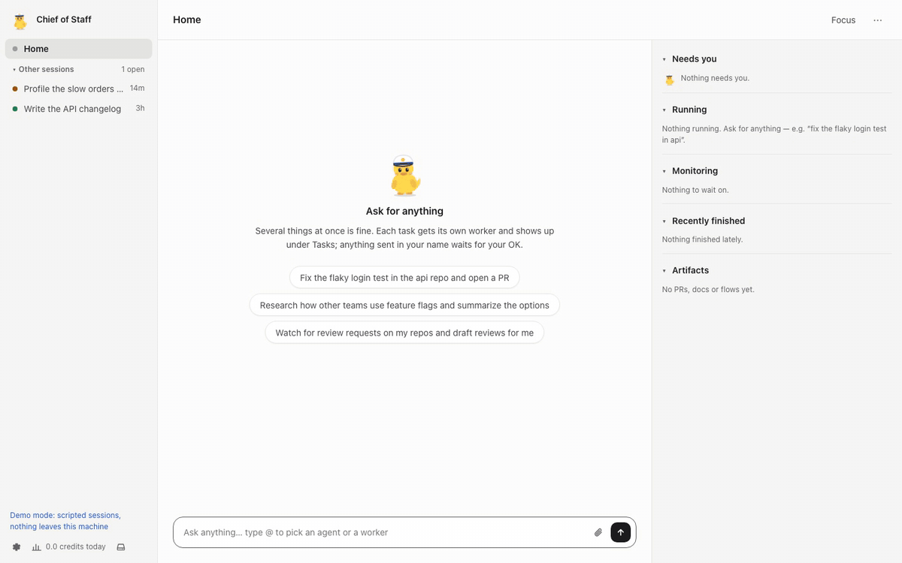
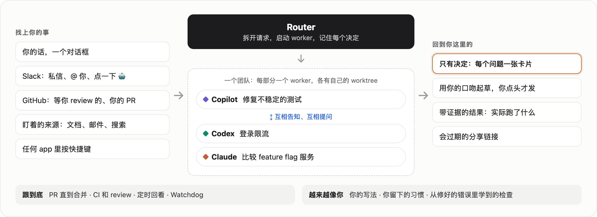
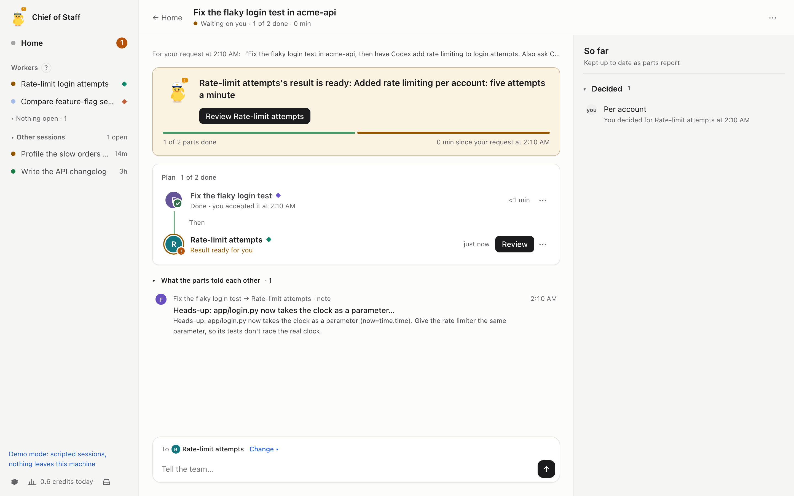
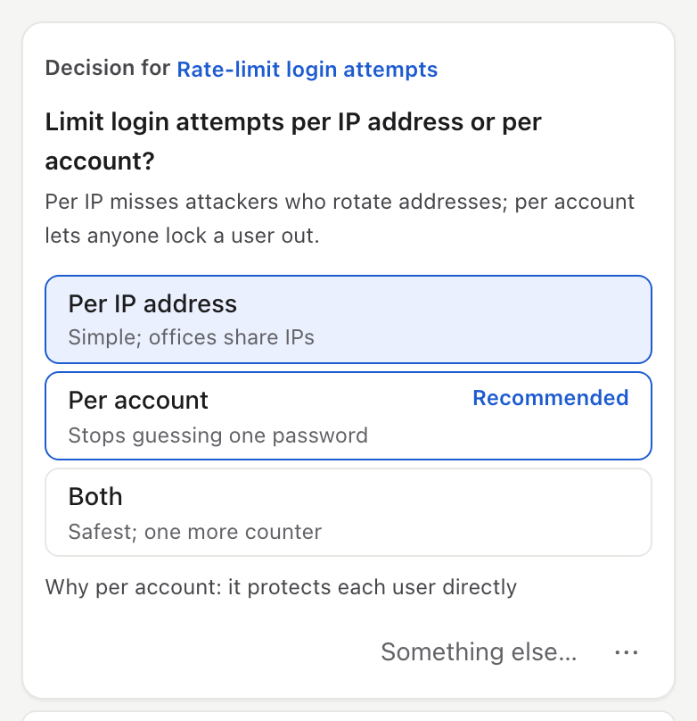
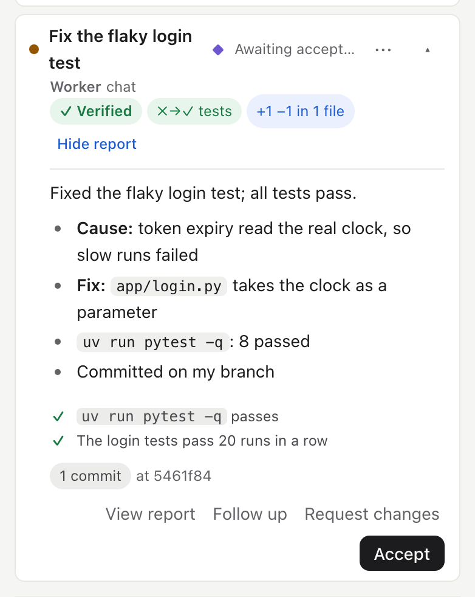
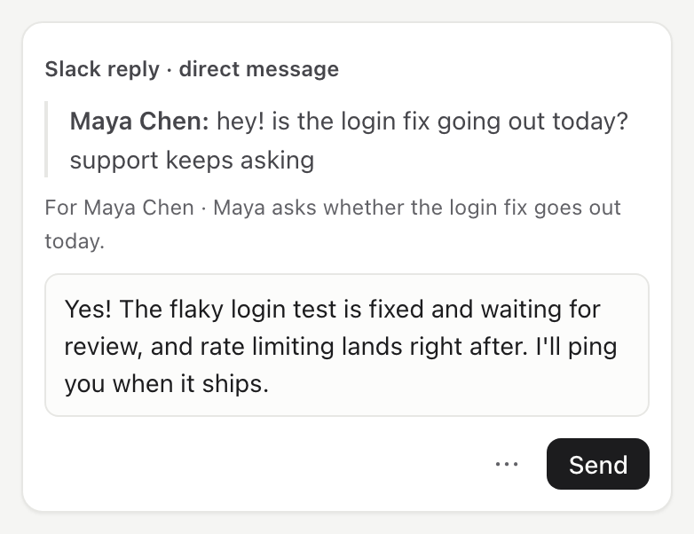
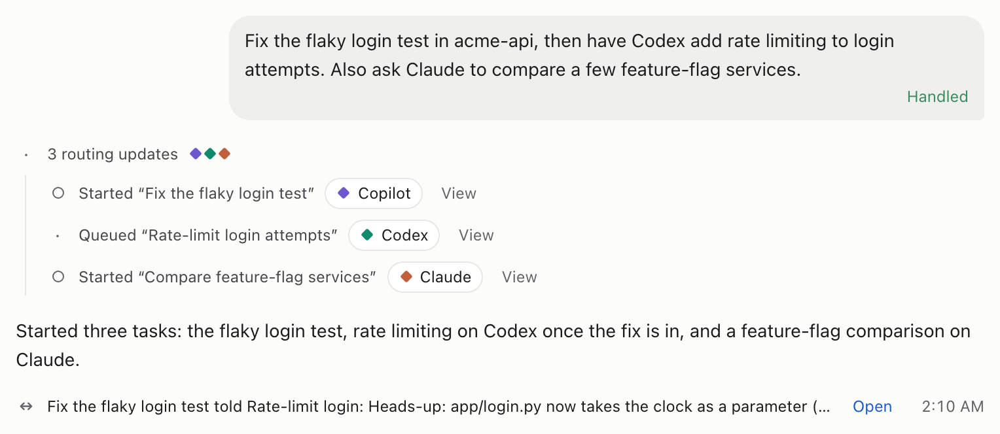
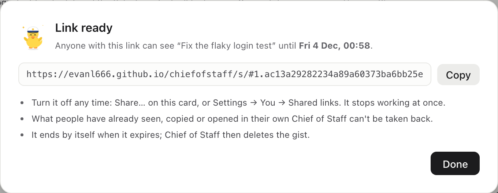

<p align="center">
  
</p>

<h1 align="center">Chief of Staff</h1>

<h3 align="center">你的工程幕僚长：替你干得越多，就越像你。</h3>

<p align="center">
  它把 Copilot、Codex、Claude 组成一支会互相沟通的团队，每件事跟到底，你在哪都能找到它，只把需要你拍板的决定交给你。
</p>

<p align="center">
  <a href="https://pypi.org/project/chiefofstaff/"></a>
  <a href="https://pypi.org/project/chiefofstaff/"></a>
  <a href="https://github.com/evanl666/chiefofstaff/blob/main/LICENSE"></a>
  
</p>

<p align="center"><a href="https://github.com/evanl666/chiefofstaff/blob/main/README.md">English</a> · <b>简体中文</b></p>

<p align="center">
  <picture>
    <source media="(prefers-reduced-motion: reduce)" srcset="https://raw.githubusercontent.com/evanl666/chiefofstaff/main/docs/images/hero.png">
    
  </picture>
  <br>
  <sub>真实界面的 demo 模式，21 秒。<a href="https://raw.githubusercontent.com/evanl666/chiefofstaff/main/docs/images/hero.mp4">高清版（MP4）</a></sub>
</p>

## 10 秒上手

```bash
uvx chiefofstaff@latest --demo   # 脚本模拟的 agent：不用登录，什么都不离开你的电脑
uvx chiefofstaff@latest          # 正式使用：先登录 Copilot CLI、Codex CLI 或 Claude Code 之一
```

没有 `uv`？`pipx run chiefofstaff --demo` 也行。浏览器会自己打开。

## 它能做什么

1. **越来越像你，也从自己的错误里学。** 它学你的写法（你发的 Slack 消息、写的 PR review、commit）和你反复提的要求；习惯经你确认才生效。worker 修好一个失败的测试后，它会提出一条检查：在有错的版本上失败、在修好的版本上通过，两边都验证过，下次同样的错误会被拦下。
2. **会互相沟通的团队。** 一个请求拆成几部分，每个 worker 跑在自己的 agent 和 git worktree 上。它们直接互相告知、互相提问，等彼此的结果，共享你做过的决定；团队页面实时显示整个计划。也可以让同一个任务在两个 agent 上各跑一遍，结果并排比较。
3. **每件事跟到底。** 帮你推着 PR 往前走：CI 挂了或者有人留了 review 意见，同一个 worker 准备好修复或回复，等你点头（*Keep my PRs moving*）。它跟着的 Slack 讨论和 PR 有新动静会直接交给对应的 worker；长时间的任务会定时回来看；Watchdog 会推一把卡住的 worker。
4. **在哪都能找到它。** 在任意 Slack 消息上点 🤖 就交给它，或者在任何 app 里按快捷键发任务。你不在电脑前时，需要你的事会发到你那里（比如 Slack 私信），你就地回复。
5. **只有决定来找你。** 每个问题一张卡片，带选项和建议。几个 worker 遇到同一个问题时共用一张卡片，你回答一次，它们都收到。每个结果都附带证据：它实际看到的测试、提交和 diff，而不只是 agent 自己说的。
6. **没有你点头，从不代表你。** 用你的口吻起草 Slack 回复和 PR review，你同意才发。任何 worker 都不能以你的身份在 GitHub 上评论、review、合并或关闭，不能推到 `main`，也不能强推别人的分支。
7. **一个链接分享。** 做完的结果可以变成一个加密、会过期的链接，任何浏览器都能打开；看起来私密的内容会先标出来，由你决定删掉。
8. **基本面。** Copilot CLI、Codex CLI、Claude Code 按任务混着用，用你已有的订阅；某个 agent 用到上限时，新任务自动在下一个上开始。能接着做你在终端里开的 session。跑在你自己的电脑上，开源（MIT）。

## 你不用再做的事

| 以前 | 用了 Chief of Staff |
| --- | --- |
| 盯着五个终端标签页，看哪个 agent 卡住了 | 一个对话框。每个任务实时显示进行到哪一步；卡住的会被推一把 |
| 在 agent 之间来回复制上下文 | worker 之间直接告诉对方改了什么 |
| 同一个问题回答三个 agent | 一张卡片，你答一次，问过的 worker 都收到 |
| 相信“测试全过了” | 证据：它跑了哪些命令、退出码、提交和 diff |
| 每个 PR 都要回去看 CI 红没红、有没有新评论 | 修复或回复已在同一个 worker 里准备好，等你点头 |
| 每条回复、每个 review 从头写 | 用你的口吻起草，你说发才发 |
| agent 下午用到上限，活就停了 | 新任务在你有的下一个 agent 上开始 |

## 工作原理

<p align="center">
  
</p>

你只跟一个 session 说话，也就是 Router。它拆开你的请求，为每一部分启动一个 worker，跑在你指定的 agent 上（没指定就用 Settings 里选的），每个 worker 有自己的文件夹和 git worktree，Router 负责记住所有决定。每个 worker 都是对应 agent 的真实 session，通过该 agent 自己的 SDK 或 app server 驱动（Copilot 的会出现在 `copilot --resume` 里）。session 之间的消息都由 Chief of Staff 标明发送者再转交，所以一条 Slack 消息冒充不了你。

## 看看界面

| | |
| --- | --- |
| <br>**团队页面**：计划、各部分之间说了什么、你做了哪些决定 | <br>**一张决定卡片**：选项、各自的含义、建议 |
| <br>**证据**：已验证、失败的测试修好了、diff、提交 | <br>**你的口吻**：起草好的 Slack 回复，你同意才发 |
| <br>**一个请求，三个 agent**：一个 worker 告诉另一个它改了什么 | <br>**一个链接分享**：加密，会过期 |

## 安全与隐私

| 自己就会做 | 需要你点头 | 绝不：任何模式下，任何 worker 都不能 |
| --- | --- | --- |
| 在自己的文件夹和 git worktree 里干活；你的 checkout 不会被动 | 以你的名义发 Slack 回复、发 PR review | 以你的身份评论、review、合并或关闭 PR，或者改 issue |
| 跑测试和构建；推送自己的 `chief/…` 分支、开 PR | 合并 PR（在卡片上点一下） | 推到 `main` 或 `master` |
| 读你允许它读的：你的代码、Slack、你的 agent 已有的工具 | 启用它学到的检查、习惯或你的个人简介 | 强推不属于它的分支 |
| 不确定就问你，不瞎猜 | 打开 *Ask first* 后：写到自己文件夹之外、`sudo`、任何强推 | 拿到你的 Slack token（任何 agent 都拿不到） |

所有东西都跑在你的电脑上，数据留在你的数据文件夹里。没有账号，没有遥测：你的代码和提示词只发给你在用的 coding agent，访问 Slack 和 GitHub 用的是你自己的登录。它自己唯一会发的请求，是每天看一次 PyPI 上有没有新版本，不带任何关于你的信息（可以关掉）。分享链接的密钥只在链接里，从不存到 GitHub。worker 的系统级沙箱在 Settings 里一个开关就能打开。[SECURITY.md](SECURITY.md) 讲清楚了沙箱、Chief of Staff 和模型各自管住什么。

## 它的位置

| | 擅长 | 还要你自己做的 |
| --- | --- | --- |
| 终端里的 coding agent | 一个任务，深入到你的代码库里 | 开每个 session、盯着它、搬运上下文、跟进 |
| 并行 agent 的面板 | 在多个 worktree 里同时开很多 session | 一个个盯、一个个回答、自己合并 |
| AI 编辑器 | 有 agent 在旁边一起写代码 | 一直待在编辑器里驱动它 |
| **Chief of Staff** | 它们之上的那一层：把你的 agent 组成团队，把事情跟到底 | 做决定 |

## 安装

需要 macOS 或 Linux（Windows 处于实验阶段，只支持 Copilot）、Python 3.11+、[uv](https://docs.astral.sh/uv/getting-started/installation/) 或 pipx，以及登录好的任意一个 coding agent：[GitHub Copilot CLI](https://docs.github.com/en/copilot/how-tos/copilot-cli)、[Codex CLI](https://developers.openai.com/codex/cli) 或 [Claude Code](https://docs.claude.com/en/docs/claude-code)。

```bash
npm install -g @github/copilot && copilot login   # 或者：codex login，或者：claude auth login
uv tool install chiefofstaff && chiefofstaff       # 或者：pipx install chiefofstaff
```

它通过终端里打印的私密链接在浏览器里打开。告诉它你的代码放在哪（比如 `~/workspace`），然后说你要做什么。可选：`gh auth login` 用来 review 和开 PR；在 Settings 里填 Slack user token（[怎么做](docs/guide.md#slack)）。更新：点侧边栏里的 **Update and restart**，或者 `uv tool upgrade chiefofstaff`。

## 了解更多

- [使用指南](docs/guide.md)：上手、概念、日常使用、agent、设置、排错（英文）
- [参考手册](docs/reference.md)：每个行为和设置的细节（英文）
- [安全](SECURITY.md) · [架构](docs/ARCHITECTURE.md) · [更新日志](CHANGELOG.md)

<details>
<summary><b>常见问题</b></summary>

**它会取代 Copilot、Codex 或 Claude Code 吗？** 不会。它用你自己的登录和订阅来运行它们，每个 worker 都还是对应 agent 的真实 session。

**要花钱吗？** 它本身不收费。每个 agent 的用量算在你在那边的订阅里：Home 上显示每个任务用了多少 Copilot credits，Usage 里有每个 agent 的用量。

**它会以我的名义发消息或合并吗？** 只在你同意时。回复、review 和合并都要你在卡片上点头才会发生；任何 worker 自己都做不了，在哪个 agent 上都一样。唯一的例外由你自己决定：在 Slack 消息上点 🤖，就等于同意它在那个讨论串里回一条。

**三个 agent 都要装吗？** 不用，任意一个就够。更多的可以在 Settings → Agents & models 里加，单个任务用 `@codex` 或 `@claude` 指定。

**可以用了吗？** 还很早期（0.1），迭代很快：会有不完善的地方，遇到问题请[提 issue](https://github.com/evanl666/chiefofstaff/issues)。

</details>

## 参与和许可

欢迎提 issue 和想法，参见 [CONTRIBUTING.md](CONTRIBUTING.md)。MIT 许可。Chief of Staff 是独立项目，与 GitHub、OpenAI、Anthropic 没有隶属关系，也不由它们制作；产品名称归各自所有者。
