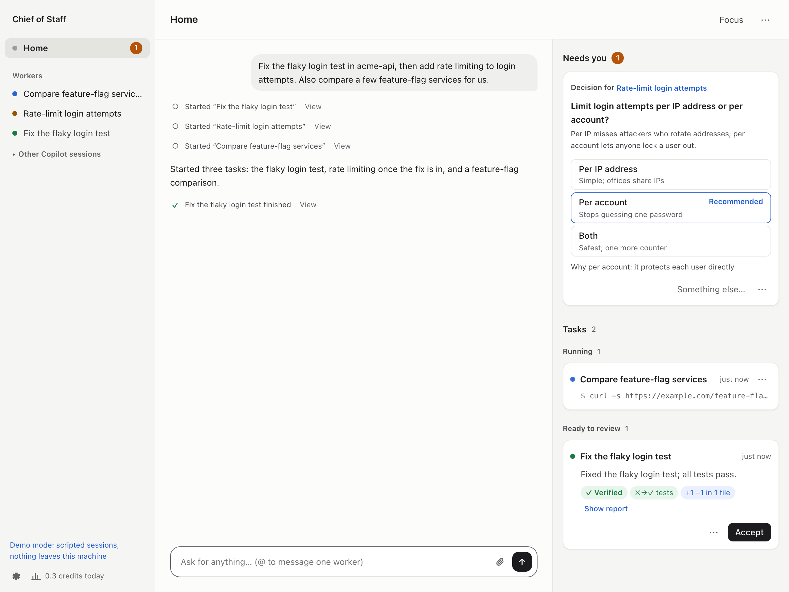

# Chief of Staff

[English](README.md) · **简体中文**

[](https://pypi.org/project/chiefofstaff/) [](https://pypi.org/project/chiefofstaff/) [](LICENSE)

在一个首页上管理你所有的 GitHub Copilot session。你说要做什么：每个任务交给一个单独的 Copilot
session，追问发给已经了解情况的那个 session；只有需要你做决定、或者有结果要检查时才来找你。

<p align="center"></p>



```bash
uvx chiefofstaff --demo    # 用脚本模拟的 session 先体验，不需要登录
```

## 为什么做这个

我平时同时开好几个 Copilot session：一个修测试，一个看 PR，一个翻日志。总要在几个终端之间来回切，看哪个卡住了、哪个在等我回答、哪个已经做完了，中间 Slack 还不停地 @我。现在我只跟一个 session
说话，也就是 Router，其余的交给 Chief of Staff。

## 能做什么

**所有工作在一个地方**
- 把一句话拆成几个任务，每个任务一个 Copilot session，可以并行，也可以按顺序。
- 追问发给做过这件事的 session，它有之前的对话和代码。
- 一个面板看所有任务的实时进度：正在做什么、谁在排队以及为什么、哪些做完了。
- 名字旁边的小鸭子船长一眼告诉你现在的情况：有事需要你时它敬礼，任务在跑时它掌舵，任务在等别的东西时它举着望远镜盯着，任务完成时它欢呼。

**结果可以核对**
- 汇报旁边列出实际观察到的东西（跑了哪些测试、提交、diff、PR 检查），没有依据的说法会标出来。
- 可以在 diff 上评论、发回去改，一键开 PR。

**只在需要你时找你**
- 每件事一张卡片：带选项和建议的决定、一个问题、一份草稿。
- 你离开电脑时，通过你指定的方式（比如公司的 Slack bot）找到你，你在那边回复就行。
- 专注模式：通知先压着，结束后给你一份总结。

**你同意后才替你说话**
- 按你的语气起草 Slack 回复和 PR review，包括 approve。
- 按你说的帮你盯着（Slack 里 @ 你的、文档评论、邮件），用你的 Copilot 现有的任何工具，包括 Glean
  或公司自己的搜索。
- 在 Slack 任意消息上点 🤖，它就变成一个任务。

**学习你的做事方式**
- 学你的写法和你反复提的要求：写法立即生效，习惯经你确认后生效。
- 把 worker 修过的错误变成检查，下次自动拦住。

**用你自己的 Copilot，跑在你自己的电脑上**
- 用你现有的 Copilot：订阅、模型、插件、skill、MCP server 和公司策略，也可以在 Settings 里再加。不需要别的 AI 服务或 API key。
- 每个 worker 有自己的文件夹和 git worktree，不会动你的代码目录。worker 和你自己的 Copilot
  session 一样运行，可以在 Settings 里打开权限检查或系统沙箱。

## 安装

需要 macOS、Linux 或 Windows（实验性支持）、Python 3.11+、[uv](https://docs.astral.sh/uv/getting-started/installation/)
（或 pipx），以及 [GitHub Copilot CLI](https://docs.github.com/en/copilot/how-tos/copilot-cli)：

```bash
npm install -g @github/copilot
copilot login
uvx chiefofstaff           # 或者：pipx install chiefofstaff && chiefofstaff
```

浏览器会通过终端里打印的私密链接打开 Chief of Staff（这个链接别给别人）。告诉它你的代码放在哪，比如 `~/workspace`，然后说你要做什么。

所有东西都在你的电脑上跑，数据存在 `~/Library/Application Support/chiefofstaff`（macOS）或
`~/.local/share/chiefofstaff`（Linux）或 `%LOCALAPPDATA%\chiefofstaff\chiefofstaff`（Windows；若使用从应用商店安装的 Python，Windows 会把它放在该 Python 的 `%LOCALAPPDATA%\Packages\...\LocalCache` 下，启动时 `Data:` 一行会显示实际位置）。Ctrl+C 停止，下次启动时 session 会接着之前的进度。参数：`--port`、`--data-dir`、`--no-browser`、`--demo`。升级：`uvx chiefofstaff@latest`。

Windows 支持为实验性：暂不支持 Send to Chief、Copilot 命令沙箱、沙箱内的自动检查，以及 Storage
中的目录大小统计（依赖 `du`）；worker
仍可以访问当前用户有权访问的文件和网络。新建的数据目录及其中的私密启动链接会通过访问控制列表设为
仅你本人（以及 SYSTEM 和 Administrators）可读；已存在的 `--data-dir` 保留原有权限，请自行确认。
存储清理看不到以管理员身份运行、位于 worker 目录中的程序：关闭 worker 前请先关掉它们。
Git 在很深的路径下仍可能遇到路径长度限制；遇到此问题时请使用较短的项目或数据目录。

从源码目录启动（完成 `uv sync --extra dev` 后）：

```powershell
.\.venv\Scripts\python.exe -m chiefofstaff
```

**可选的登录**
- **GitHub**：用你所有的账号各 `gh auth login` 一次，用来 review 和开 PR。
- **Slack**：在 Settings 里粘贴 user token（[怎么获取](docs/guide.md#slack)，英文），或者通过你的
  Copilot 已有的工具（比如 Glean）访问 Slack。
- **其他服务**（文档、issue 系统）：worker 需要时会出现一张登录卡片。

## 工作原理

每个 session 都是普通的 Copilot CLI session，通过 Copilot SDK 驱动，在 `copilot --resume` 里叫
"Chief of Staff · …"。session 之间从不直接对话：它们调用 `spawn_worker`、`report`、`tell_session`
这类工具，由 Chief of Staff 传话，并标明是谁发的，所以一条 Slack 消息没法冒充成你。一起干活的 worker
把对方需要的信息直接传给对方，Router 会收到一份副本。

```
你 ── 首页 ── Router ── 任务 ──► worker · worker · worker
                ▲                (各自的文件夹和 worktree)
Slack、GitHub ──┘   草稿 ──────► 等你批准
你的关注            Watchdog ──► 推一把卡住的 worker
```

## 更多文档（英文）

- [使用指南](docs/guide.md)
- [架构](docs/ARCHITECTURE.md)
- [安全说明](SECURITY.md)：哪些由系统沙箱保证，哪些由 Chief of Staff 保证，哪些靠模型遵守指令
- [更新日志](CHANGELOG.md)

## 当前状态

早期版本（0.1），会有粗糙的地方。Copilot 用量照常算在你的订阅里，首页会显示每个任务用了多少
credits。欢迎提 issue；想参与开发请看 [CONTRIBUTING.md](CONTRIBUTING.md)。

## 许可证

MIT。Chief of Staff 是独立项目，不是 GitHub 出品，也与 GitHub 无关。GitHub Copilot 是 GitHub, Inc.
的商标。
